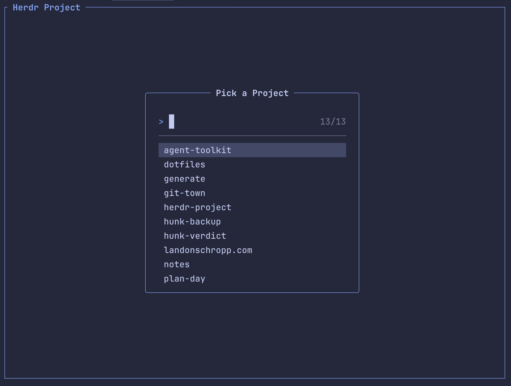
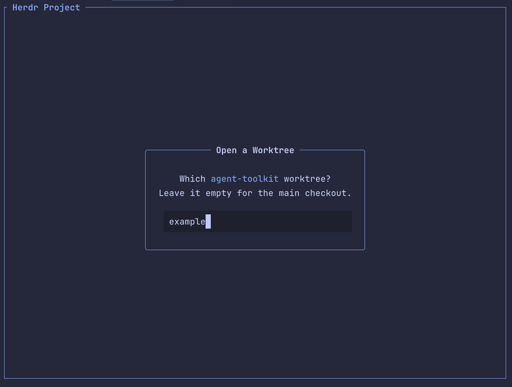

> [!WARNING]
> **This repository is 100% vibe coded.** The author did not read any of the code. Use it at your own risk.

# Herdr Project

[](LICENSE)

Open [Herdr](https://herdr.dev) workspaces with preconfigured layouts.

## Why?

Herdr workspaces and worktrees tend to need the same tabs and commands every time, and recreating
them by hand is a pain. This plugin opens them with their tabs preconfigured, the way
[tmuxinator](https://github.com/tmuxinator/tmuxinator) does for tmux. With a `default` project and a
glob of where your repositories live, most projects need no [configuration](#configuration) of
their own.

## How It Works

The picker asks two questions:

1. **Which project?** Fuzzy-search your projects and pick one. Escape cancels.
2. **Which worktree?** Type a branch name to create that worktree, or open it if it already exists.
   Leave it empty for the main checkout. Escape goes back to the project.





## Installation

1. Install [Bun](https://bun.sh) and [Herdr](https://herdr.dev).

2. Install the plugin from a clone:

   ```sh
   git clone https://github.com/LandonSchropp/herdr-project.git
   cd herdr-project
   herdr plugin link .
   ```

3. Bind the action to a key in `~/.config/herdr/config.toml`:

   ```toml
   [[keys.command]]
   key = "cmd+n"
   type = "plugin_action"
   command = "landonschropp.herdr-project.project"
   description = "open a project"
   ```

## CLI

Everything the picker does is also available non-interactively, for agents and scripts. If no Herdr
server is running, it starts a headless one, so it works from a scheduled job.

```sh
herdr-project list [--json]
herdr-project open --project <name> [--worktree <branch>] [--name <label>] [--prompt <text>] [--no-focus]
herdr-project close --project <name> [--worktree <branch>] [--name <label>] [--yes]
```

- **`list`**: Prints the configured projects. `--json` prints them as JSON.
- **`open`**: Opens the project's main checkout, or a worktree on `--worktree`'s branch, creating it
  if needed. `--name` labels the workspace, `--prompt` overrides the project's
  [prompt](#prompts), and `--no-focus` opens it in the background.
- **`close`**: Closes the project's main workspace, or removes `--worktree`'s worktree. `--name`
  picks which workspace, and `--yes` skips the confirmation.

### Agent Skill

The `herdr-project` [agent skill](skills/herdr-project/SKILL.md) teaches coding agents to use the
CLI. Install it with:

```sh
npx skills add LandonSchropp/herdr-project --skill herdr-project
```

## Tabs

A project's tabs are laid out by a `workspace.created` hook rather than by whatever opened the
workspace, so any workspace whose repository is a configured project gets its tabs — including
ones created from Herdr's own UI, and ones Herdr opens on its own when grouping a worktree under
its parent. Workspaces without a worktree, or whose repository isn't a configured project, are
left alone.

## Project Name

Herdr's sidebar labels a linked worktree with its branch, which doesn't say which project it
belongs to. The plugin reports each workspace's project name as a `project` token, so a sidebar row
can show it:

```toml
[ui.sidebar.spaces]
rows = [["state_icon", "workspace"], ["$project"]]
```

The name is the project's `name` from the configuration, falling back to its directory's name.

## Untracked Files

A new Git worktree has none of the main checkout's untracked files, such as `.env`. The plugin
copies them in for any repository, configured or not, choosing them with two optional include files
in `.gitignore` syntax:

- **`~/.config/git/worktreeinclude`** (or `$XDG_CONFIG_HOME/git/worktreeinclude`): the patterns
  every repository gets, which is where something like `.env*` belongs.
- **`.worktreeinclude`** in a repository's main checkout: that repository's own patterns.

The repository's patterns apply over the global ones, so a repository can cancel a global pattern by
negating it (`!.env`). Its `.worktreeinclude` isn't committed, so it's always read from the main
checkout.

A path the worktree already has is never overwritten. A matched directory is copied whole when the
workspace opens, so think twice before adding a large directory.

## Configuration

Settings live in `~/.config/herdr-project/settings.json`, or wherever `HERDR_PROJECT_SETTINGS`
points. Every field is optional.

```json
{
  "projectPaths": ["~/Development/*", "~/.dotfiles", "~/Notes"],
  "flat": true,
  "projects": [
    {
      "name": "default",
      "focusedTab": "claude",
      "tabs": [
        { "name": "shell" },
        { "name": "neovim", "command": "nvim" },
        { "name": "claude", "command": "claude" }
      ]
    },
    { "name": "landonschropp", "path": "~/Development/landonschropp.com" },
    { "path": "~/Notes", "prompt": "Read the vault's conventions before you touch anything." }
  ]
}
```

- **`projectPaths`**: Where to find projects. Every Git repository a glob matches becomes a project
  named after its directory, and a path without wildcards is a single repository.
- **`flat`**: Whether to open each workspace as its own top-level row instead of grouped under its
  repository. Defaults to `false`. See [Flat Workspaces](#flat-workspaces).
- **`projects`**: Project definitions, each merged over the `default` project below.

### The `default` project

The project named `default` is a layout, not somewhere to open. It has no `path`, never appears in
the picker, and supplies the tabs every other project inherits. A tab with no `command` is a plain
shell. Without a `default` project, projects get a single shell.

Its `focusedTab` names the tab to focus when a workspace opens. A project without that tab opens on
its first tab instead.

### Declaring a project

Declare a project only to override what discovery found:

- **A different name**: Such as `.dotfiles` shown as `dotfiles`.
- **A different layout**: Tabs other than the default's.
- **A prompt**: Instructions the project's agent always starts on.

Only `path` is required; everything else defaults to the directory's name and the `default`
project's tabs. A declared project replaces the discovered one at the same path.

A declared project doesn't have to be a Git repository. It then has no worktrees and always opens as
a plain workspace on its directory, which suits work that spans repositories.

### Prompts

A project's `prompt` is sent to the workspace's first idle agent once it starts. A prompt Herdr
doesn't deliver is reported as an error rather than dropped silently.

Only the picker and the CLI send prompts, so a workspace opened from Herdr's own UI gets the
project's tabs but not its prompt. `--prompt` replaces the project's prompt rather than queuing
behind it.

### Flat Workspaces

Herdr groups a worktree under its repository and opens the repository's main workspace beside it.
With `flat`, every workspace the plugin opens is its own top-level row instead.

Herdr doesn't know a flat workspace is a worktree, so the `branch` and `git_status` sidebar tokens
are empty and `herdr worktree remove` refuses it. The label still shows the branch, and
`herdr-project close` removes the checkout with Git.

## Development

```sh
bun install
bun test           # run the test suite
bun run check-types
bun run lint
```

Run the picker outside Herdr to iterate on the UI:

```sh
bun run src/index.tsx
```

## License

[MIT](LICENSE).
